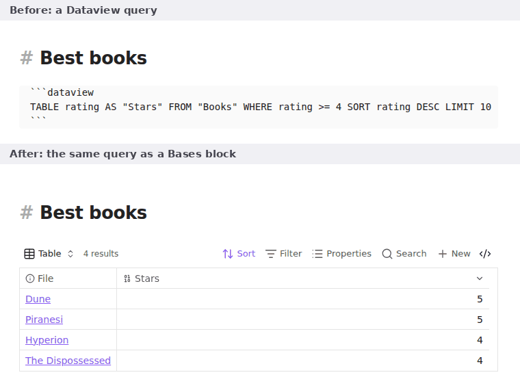

# Dataview to Bases

Convert Dataview queries into Bases blocks, and see which queries in your vault can be converted. A migration helper for people moving off Dataview, which has had no release in over a year, to the Bases core feature.



It also moves Dataview inline fields (`status:: done`) into properties, so Bases can see them.

It converts the common queries (`TABLE`, `LIST`, `FROM`, `WHERE`, `SORT`, `LIMIT`, `GROUP BY`) and tells you plainly why it leaves the rest alone. It never converts anything on its own, and the vault scan never edits a note.

## Commands

| Command | What it does |
|---|---|
| Convert Dataview query at cursor to Bases | Replaces the `dataview` block under the cursor with a `base` block. |
| Convert all Dataview queries in this note | Converts every convertible query in the note and leaves the others as they are. |
| Scan vault for Dataview queries | Writes a report note: for each note, each query and whether it is convertible, partly convertible or not, with the reasons. Also lists the notes that have inline fields. Edits nothing else. |
| Move inline fields to properties in this note | Copies the note's inline fields into its properties (and, by default, removes the field lines from the text). |
| Move inline fields to properties in the vault… | Shows every note with inline fields and the property each would become. Tick the notes you want, then apply. |
| Undo the last move of inline fields | Puts the notes from the last move back as they were. |

Each conversion is one change in the editor, so a single **Undo** brings every query back. By default the original query stays under the new block inside a comment (hidden in reading view; its tags and links do not count for the note). Turn that off in the settings.

## Moving inline fields to properties

Bases reads only properties, so a query on `status:: done` written in the text shows nothing for that note. The move commands turn inline fields into properties:

- A field on a line of its own (`status:: done`) and a field inside a sentence (`[due:: 2026-10-10]` or `(rating:: 4)`) are both found. Code blocks, inline code, math, comments and the front matter are skipped. A field in a list item or a quote is moved only when it is in brackets.
- The key is kept as you wrote it when it is a valid property name (`Status`, `due_date`, `año`). Otherwise it is written the way Dataview reads it: lowercase, spaces as hyphens (`Due Date` becomes `due-date`).
- Values get a type: numbers, `true` and `false`, dates and date-times (`2026-10-10`, `2026-10-10T09:30`) and links (`[[Some note]]`, kept as a link in the property). A value of several links separated by commas becomes a list. `tags`, `aliases` and `cssclasses` become lists. Anything else stays text, exactly as written.
- A key that appears more than once in a note becomes one list property.
- A property the note already has is never overwritten. If its value is different, the field is reported as a conflict and stays in the text; if it is the same, the field is just dropped. A field with no value is skipped.
- With the setting **Remove the fields from the text** (on by default), fields on a line of their own are taken out of the text. Fields inside a sentence are prose, so they always stay and are only copied.

The vault command shows a preview first: each note, the fields found, the property each becomes and the conflicts, with a checkbox per note. Nothing changes until you press the button. **Undo the last move of inline fields** puts back every note of the last move; a note you edited after the move is left as it is.

## Example

````
```dataview
TABLE rating AS "Stars" FROM "Books" WHERE rating >= 4 SORT rating DESC LIMIT 10
```
````

becomes

````
```base
filters:
  and:
    - 'file.inFolder("Books")'
    - 'note.rating >= 4'
properties:
  file.name:
    displayName: File
  note.rating:
    displayName: Stars
views:
  - type: table
    name: Table
    limit: 10
    sort:
      - property: note.rating
        direction: DESC
    order:
      - file.name
      - note.rating
```
````

## What converts

- `TABLE` (with `AS` aliases and `WITHOUT ID`) becomes a table view; `LIST` becomes a list view.
- `FROM` with folders, files, `#tags`, `[[links]]` (notes that link to it), `[[]]` (notes that link to this one), and `and`, `or`, `-`/`!` and parentheses.
- `WHERE` with comparisons, `and`/`or`/`!`, `= null` and dates (`date(today)`, `date(now)`, `dur(7 days)`, date plus or minus a duration).
- Functions, in `WHERE`, in columns and in `SORT`:
  - Text: `lower`, `replace`, `regextest`, `regexmatch`, `regexreplace`, `split`, `join`, `startswith`, `endswith`, `substring`, `truncate`, `padleft`, `padright`, `length`, `contains`, `icontains`, `string`.
  - Numbers: `round`, `trunc`, `floor`, `ceil`, `abs`, `min`, `max`, `number`.
  - Lists: `sum`, `average`, `min` and `max` of a list, `map`, `filter`, `any`, `all`, `none` (with a lambda such as `(h) => h > 8`, or without one), `nonnull`, `contains`, `econtains`, `reverse`, `sort`, `unique`, `flat`, `slice`, `length`.
  - Others: `typeof(x) = "number"` (any Dataview type name), `choice`, `default`, `date`, `dur`, `dateformat`, `striptime`, `link`.
- A regular expression in `regextest`, `regexmatch`, `regexreplace` or `split` must be written in the query (`regexmatch("\d{4}", year)`), because Bases needs it as a `/…/` pattern.
- `sum`, `min` and `max` of a list need Obsidian 1.11 or newer; on an older version those queries are reported as not convertible.
- `SORT` with several keys, `LIMIT` with a number, `GROUP BY` one field.
- `file.name`, `file.link`, `file.path`, `file.folder`, `file.ext`, `file.size`, `file.ctime`, `file.mtime`, `file.cday`, `file.mday`, `file.tags`, `file.outlinks`, `file.inlinks` and `this.file.*`.
- Columns that are not plain properties become formulas, named after what they were.

## What does not convert

Left unchanged, with the reason in the notice or the report:

- `TASK` and `CALENDAR` queries, `dataviewjs` blocks and inline `= …` queries.
- `FLATTEN`, and `FROM outgoing(…)` or `csv(…)` sources.
- Functions Bases has no equivalent for: `upper` (Bases has `lower` and `title`, but no upper case), `product`, `containsword`, `extract`, `object`, `minby`, `maxby`, `firstvalue`, `display`, `elink`, `embed`, `meta`, `hash`, `localtime`, `durationformat` and `currencyformat`; `file.tasks`, `file.lists`, `file.day`, `file.starred`.
- `typeof()` used for anything but a comparison with a type name, a lambda that reads a field of a list item (`(p) => p.file.name`) or the item of an outer lambda, `sort()` with a key, and `sum`, `length`, `map` and the like over the `rows` of a `GROUP BY`.
- `truncate`, `padleft` and `padright` with a length that is not a number written in the query, and a regular expression that is not written in the query.

## Differences you should check

A query is reported as **partly** convertible when the result may not match Dataview. The notice and the report say which of these applies:

- **Inline fields.** Bases reads only properties in the frontmatter. If a field the query uses is written inline somewhere in your vault (`status:: done`, `[due:: 2026-10-10]`), the query is reported as partly, because the converted table would be empty or wrong for those notes. Move the field into the frontmatter, or keep Dataview for that query.
- **`contains()` on a property.** On a list property, Dataview also matches part of an item (`contains(authors, "Smi")` finds "Smith"), while Bases matches whole items only.
- **`contains()` on text.** Dataview tells upper and lower case apart; Bases does not (`contains(file.name, "Ann")` also finds "ANNA"). `econtains` matches whole list items in both, but on text it has the same difference. Text with no letters, such as `"2026"`, converts exactly.
- **`sum`, `average`, `min` and `max` of a list.** Bases counts only the numbers in the list (Dataview also adds up text and durations and compares dates), and gives nothing for a single value that is not a list. A list of numbers written in the query converts exactly.
- **`any`, `all` and `none` on a property.** For a note without the list, Dataview can still answer true or false; Bases leaves the note out.
- **`min(a, b)` and `max(a, b)` with a property.** When one of the values is missing, Dataview uses the others and Bases shows nothing.
- **`round(x, 2)`.** For a negative number exactly halfway, Dataview rounds away from zero (`-1.25` to `-1.3`) and Bases toward it (`-1.2`). `round(x)` converts exactly.
- **`substring()`** with positions that are computed, negative or reversed: Bases uses `slice()`, which counts negative positions from the end and does not swap them.
- **`split()`** with a separator that is not written in the query (Dataview reads it as a regular expression, Bases as plain text), or with a group `(…)` in the pattern.
- **`GROUP BY`.** Dataview shows one row per group; Bases lists every note under its group heading.
- **`this.field`.** Properties of the current page are mapped to `this.note.field`; check the result.
- **Property spelling.** Dataview matches `Due Date` as `due-date`. Bases uses the property name exactly as written in the query, so names with a hyphen or a space are reported as partly and converted to a formula that reads the name as written.
- **Clause order.** Dataview runs `LIMIT` where you wrote it (`LIMIT 10 SORT x` sorts only ten notes); Bases always filters, sorts, then limits.

Translated without a warning: `x = null` stays `x == null` (so `0`, `false` and an empty text are values, as in Dataview), `!x` becomes `!x.isTruthy()` (Bases would otherwise leave out the notes without `x`, which Dataview lists), `length(x)` gives 0 for a missing `x` as in Dataview, `regexmatch()` must match the whole text unless the pattern starts with `^` or ends with `$`, `truncate`, `padleft`, `padright` and `trunc` are spelled out with `slice`, `repeat`, `ceil` and `floor`, `typeof(x) = "string"` leaves out links (Bases counts a link as text), a function of a missing value stays empty, `default(x, y)` only replaces a missing value, `contains(file.tags, "#x")` becomes `file.hasTag("x")`, and `dateformat()` formats are translated to the common Bases ones (unusual tokens are reported as not convertible).

The converted block is what Bases reads, so you can edit it after converting, and **Bases** shows the result right away in the note.

## Settings

| Setting | Default | What it does |
|---|---|---|
| Keep the original query | on | Leaves the query under the new block in a hidden comment. |
| Report note | `Dataview to Bases report.md` | Where the vault scan writes its report. Replaced on every scan. |
| Show Pro tips | on | A one-line tip about Dataview to Bases Pro in one place (see [Pro](#pro) below). Off hides it for good. |

## Notes

- Needs a version of Obsidian with Bases (1.10 for the list view). The plugin only writes text; it does not need Dataview installed.
- No network use, no data leaves your vault. The Pro tip (see [Pro](#pro)) is fixed text and sends nothing.

## Pro

[Dataview to Bases Pro](https://perezamadorluisenrique-gif.github.io/pro/dataview-to-bases/) is an optional paid companion (one-time payment) for moving a whole vault: it converts every note in one go with a preview and undo, runs each converted query in both Dataview and Bases and lists the ones that differ, fixes mixed property types, and writes a migration report. Everything described above stays free in this plugin, and this plugin never needs Pro.

**Pro tips (static, inside this plugin only).** Dataview to Bases shows a one-line tip about Dataview to Bases Pro in one place: in the notice that **Convert Dataview query at cursor**, **Convert all Dataview queries in this note** and **Scan vault for Dataview queries** already show, and only when at least one query was left unconverted or converted only partly. It appears at most once every 14 days. The text is fixed and ships with the plugin: nothing is loaded from the internet, nothing is counted or sent, and **Learn more** only opens the Pro page in your browser. **Don't show again** on the tip, or the **Show Pro tips** setting, turns it off for good.

## Installation

In Obsidian, open **Settings → Community plugins → Browse** and search for "Dataview to Bases".

## More plugins by Siulved54

| Plugin | What it does | Source |
| --- | --- | --- |
| [Shared Blocks](https://obsidian.md/plugins?id=shared-blocks) | Write a block of text once and reuse it in any note. Edit the source and every reference re-renders live. | [shared-blocks](https://github.com/perezamadorluisenrique-gif/shared-blocks) |
| [Text Case and Cleanup](https://obsidian.md/plugins?id=text-format) | Change case, make camelCase or slugs, sort lines and remove duplicates, and repair text pasted out of a PDF, without touching code or URLs. | [text-format](https://github.com/perezamadorluisenrique-gif/text-format) |
| [Typography as You Type](https://obsidian.md/plugins?id=typography-as-you-type) | Curly quotes, dashes and ellipses as you type, kept out of code and maths, with Backspace to take one back. | [smart-typography-plugin](https://github.com/perezamadorluisenrique-gif/smart-typography-plugin) |
| [Section Numbering](https://obsidian.md/plugins?id=section-numbering) | Number headings as an outline (1, 1.1, 1.2) and keep every link to them working when they renumber. | [section-numbering](https://github.com/perezamadorluisenrique-gif/section-numbering) |
| [Spreadsheet to Table](https://obsidian.md/plugins?id=spreadsheet-to-table) | Paste cells from Excel or Google Sheets as a Markdown table with a real header, insert CSV files, and copy tables back out. | [spreadsheet-to-table](https://github.com/perezamadorluisenrique-gif/spreadsheet-to-table) |
| [Hybrid Line Numbers](https://obsidian.md/plugins?id=hybrid-line-numbers) | Relative and hybrid line numbers for Vim-style jumps, where a folded section counts as one line. | [hybrid-line-numbers](https://github.com/perezamadorluisenrique-gif/hybrid-line-numbers) |
| [List Item Callouts](https://obsidian.md/plugins?id=list-item-callouts) | Colour a single list item as a callout by starting it with a character such as `&`, `!` or `?`. | [list-item-callouts](https://github.com/perezamadorluisenrique-gif/list-item-callouts) |
| [Folder Counts](https://obsidian.md/plugins?id=folder-counts) | See how many notes or files each folder holds, right in the file explorer, with a vault total and folder exclusions. | [folder-counts](https://github.com/perezamadorluisenrique-gif/folder-counts) |
| [Note Reading Time](https://obsidian.md/plugins?id=note-reading-time) | Reading time of the current note or your selection in the status bar, optionally saved to a property. | [note-reading-time](https://github.com/perezamadorluisenrique-gif/note-reading-time) |
| [Task Rollover](https://obsidian.md/plugins?id=task-rollover) | Roll unfinished tasks from your last daily note into today's when it is created, with a real undo. | [task-rollover](https://github.com/perezamadorluisenrique-gif/task-rollover) |
| [Zoom Into Section](https://obsidian.md/plugins?id=zoom-into-section) | Zoom into a heading or list item to see only it and its contents, with a breadcrumb bar to climb back out. | [zoom-into-section](https://github.com/perezamadorluisenrique-gif/zoom-into-section) |
| [Link Title on Paste](https://obsidian.md/plugins?id=link-title-on-paste) | Paste a web address and get a Markdown link with the page's title, fetched in the background and undone in one step. | [link-title-on-paste](https://github.com/perezamadorluisenrique-gif/link-title-on-paste) |
| [Update Radar](https://obsidian.md/plugins?id=update-radar) | Checks your installed community plugins for updates in the background, shows what changed, and flags the ones that look abandoned. | [community-update-checker](https://github.com/perezamadorluisenrique-gif/community-update-checker) |
| [Line Editing Commands](https://obsidian.md/plugins?id=line-editing-commands) | Duplicate, join, sort and reverse lines, insert blank lines and jump to a line number, with multi-cursor support. | [line-editing-commands](https://github.com/perezamadorluisenrique-gif/line-editing-commands) |
| [Note Mover Rules](https://obsidian.md/plugins?id=note-mover-rules) | Move notes into folders by ordered rules on tags, properties, titles and paths, with a preview before any bulk move. | [note-mover-rules](https://github.com/perezamadorluisenrique-gif/note-mover-rules) |
| [Tab History](https://obsidian.md/plugins?id=tab-history) | Keeps each tab's back and forward history across restarts, and adds commands to move, maximize and close tabs. | [tab-history](https://github.com/perezamadorluisenrique-gif/tab-history) |
| [URL Cards](https://obsidian.md/plugins?id=url-cards) | Shows web addresses as cards with title, description and image, and reads existing cardlink blocks. | [url-cards](https://github.com/perezamadorluisenrique-gif/url-cards) |
| [Vim Config](https://obsidian.md/plugins?id=vim-config) | Loads a vimrc-style file from your vault so your key mappings and editor commands are ready when vim mode starts. | [vim-config](https://github.com/perezamadorluisenrique-gif/vim-config) |
| [Task Archive](https://obsidian.md/plugins?id=task-archive) | Moves completed tasks, with their sub-items, into an archive section or note. | [task-archive](https://github.com/perezamadorluisenrique-gif/task-archive) |
| [Revisit Later](https://obsidian.md/plugins?id=revisit-later) | Link the current note into a future daily note, with a date typed in plain English, so it comes back when you want to review it. | [revisit-later](https://github.com/perezamadorluisenrique-gif/revisit-later) |
| [Explorer Colors Plus](https://obsidian.md/plugins?id=explorer-colors-plus) | Color files and folders in the file explorer, with a palette, cascading to children, and import from File Color. | [explorer-colors-plus](https://github.com/perezamadorluisenrique-gif/explorer-colors-plus) |
| [Book Lookup](https://obsidian.md/plugins?id=book-lookup) | Create book notes from Open Library or Google Books, with cover images, ISBN search and Book Search compatible templates. | [book-lookup](https://github.com/perezamadorluisenrique-gif/book-lookup) |
| [Web Search Menu](https://obsidian.md/plugins?id=web-search-menu) | Search the web for selected text or the note title from the right-click menu, with engines you define. | [web-search-menu](https://github.com/perezamadorluisenrique-gif/web-search-menu) |
| [Word Lookup](https://obsidian.md/plugins?id=word-lookup) | Look up any word in a sidebar dictionary with definitions, phonetics, synonyms and antonyms, or create a note for it. | [word-lookup](https://github.com/perezamadorluisenrique-gif/word-lookup) |
| [Quick Translate](https://obsidian.md/plugins?id=quick-translate) | Translate the selection or a whole note into another language with no account, keeping links, code and front matter untouched. | [quick-translate](https://github.com/perezamadorluisenrique-gif/quick-translate) |
| [Dice Rolls](https://obsidian.md/plugins?id=dice-rolls) | Inline dice rolls you click to reroll, in Live Preview and Reading view, with full dice notation, a roll dialog and a roll history. Reads Dice Roller notes. | [dice-rolls](https://github.com/perezamadorluisenrique-gif/dice-rolls) |
| [Claude Studio](https://obsidian.md/plugins?id=claude-studio) | Notion-style AI writing, chat and vault tools powered by your local Claude Code CLI. | [claude-studio](https://github.com/perezamadorluisenrique-gif/claude-studio) |
| [Book Studio](https://obsidian.md/plugins?id=book-studio) | Turn notes into a print-ready paperback PDF and an EPUB 3, entirely on your device. | [book-studio](https://github.com/perezamadorluisenrique-gif/book-studio) |
| [Emoji Search](https://obsidian.md/plugins?id=emoji-search) | Insert emojis from a searchable picker or by typing a :shortcode. | [emoji-search](https://github.com/perezamadorluisenrique-gif/emoji-search) |
| [Inline TOC](https://obsidian.md/plugins?id=inline-toc) | Show a live table of contents inside any note with a toc code block, or insert a plain Markdown one. | [inline-toc](https://github.com/perezamadorluisenrique-gif/inline-toc) |
| [Run Code Blocks](https://obsidian.md/plugins?id=run-code-blocks) | Adds a Run button to code blocks and shows the output right below, for JavaScript, Python, shell and more. | [run-code-blocks](https://github.com/perezamadorluisenrique-gif/run-code-blocks) |
| [Canvas Finder](https://obsidian.md/plugins?id=canvas-finder) | Fuzzy-search the cards and files on a canvas and jump straight to the match. | [canvas-finder](https://github.com/perezamadorluisenrique-gif/canvas-finder) |
| [Folder Index Notes](https://obsidian.md/plugins?id=folder-index-notes) | Keeps an index note in each folder up to date with links to the notes and subfolders inside it. | [folder-index-notes](https://github.com/perezamadorluisenrique-gif/folder-index-notes) |
| [Random Note Filters](https://obsidian.md/plugins?id=random-note-filters) | Open or link a random note from a folder, tag, property or the current search results. | [random-note-filters](https://github.com/perezamadorluisenrique-gif/random-note-filters) |
| [Split by Heading](https://obsidian.md/plugins?id=split-by-heading) | Split a note into one note per heading, with links back in the source. | [split-by-heading](https://github.com/perezamadorluisenrique-gif/split-by-heading) |

All of them are in the community directory: Settings -> Community plugins ->
Browse, then search for the name. Demos and install links for every one:
[the catalog](https://perezamadorluisenrique-gif.github.io/catalog/).

### Pro and templates

Optional paid extras, one-time payment. Everything in the free plugins stays free.

- [Update Radar Pro](https://perezamadorluisenrique-gif.github.io/pro/update-radar/): A copy before every update, undo a whole update session, safe start after a broken update.
- [Book Studio Pro](https://perezamadorluisenrique-gif.github.io/pro/book-studio/): Genre themes, a back-of-book index, box sets, several editions and a sales kit for Book Studio.
- [Section Numbering Pro](https://perezamadorluisenrique-gif.github.io/pro/section-numbering/): Numbering profiles, cross-references, multi-note documents and Word export.
- [Typography Pro](https://perezamadorluisenrique-gif.github.io/pro/typography/): Your own typography profiles and dialogue dashes for Typography as You Type.
- [Text Case Pro](https://perezamadorluisenrique-gif.github.io/pro/text-case/): Vault-wide find and replace and per-folder recipes for Text Case.
- [Dataview to Bases Pro](https://perezamadorluisenrique-gif.github.io/pro/dataview-to-bases/): Fixes property types and checks the values before you switch to Bases.
- [KDP Book Vault](https://perezamadorluisenrique-gif.github.io/pro/kdp-book-vault/): A ready-made book vault for Book Studio, with two sample books.
- [Thesis and Report Vault](https://perezamadorluisenrique-gif.github.io/pro/thesis-vault/): A thesis and report vault numbered with Section Numbering.
- [Writer bundle](https://perezamadorluisenrique-gif.github.io/pro/bundles/writer/): Typography Pro and Text Case Pro together.
- [Author bundle](https://perezamadorluisenrique-gif.github.io/pro/bundles/author/): Book Studio Pro, KDP Book Vault and Typography Pro together.
- [Academic bundle](https://perezamadorluisenrique-gif.github.io/pro/bundles/academic/): Section Numbering Pro, the Thesis and Report Vault and Typography Pro together.
- [All Obsidian bundle](https://perezamadorluisenrique-gif.github.io/pro/bundles/all-obsidian/): Every Obsidian Pro and template in one purchase.

Follow new plugins and updates on X: [@luenpereza](https://x.com/luenpereza)
